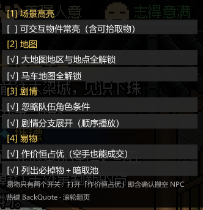

# WulinTweaks

**《大侠立志传》（Hero's Adventure: Road to Passion）微调套件**
场景高亮 / 大地图解锁 / 剧情条件放宽 / 剧情分支展开 / 剧情期间显真名 / 易物通吃

基于 BepInEx 6（IL2CPP）的 Harmony 插件。运行时按 `` ` `` 呼出面板，**所有开关默认关闭**（即原版行为），按需打开；面板上改动会立即写进 cfg，下次启动沿用上次状态。



---

## 功能

| # | 功能 | 默认 | 说明 |
|---|------|------|------|
| ① | **场景高亮** | 关 | 进入场景时扫描一次，给可交互物体加描边。跳过建筑本体（房子、城墙等只显示轮廓的物件）；地面物品只点亮可拾取的（`TempID > 0`），这一条恒开、不做开关 |
| ② | **大地图解锁** | 关 | 大地图所有地点默认可见、可直接前往；马车地图图标同样全部放开 |
| ③ | **剧情条件放宽** | 关 | 触发 Scenario 时忽略「队伍中必须存在某角色」的判定（人不在队也照演）。**含「结缘界面」的图跳过不放宽**（那类图收尾会写情缘/武功/buff，人不在队会写坏人物数据，见下节）；彩蛋类条件（图里点了别人的角色）只放宽、不动队伍；任何情况下都不动队伍 |
| ④ | **剧情分支展开** | 开 | 把「某角色是否在队」的互补分支（Negate=0/1 兄弟对）由 if/else 改成**顺序播放**：先播队内有该角色的那几段，再播队内没有时的兜底，最后汇合。**通用规则**（1.10.0 起不再限定某张图；跳过嵌套门对 / 无出口 / 两侧都不是单节点剧情的情形）—— 它只改剧情走线，不改变条件判定规则。接管方式是把门的 `HoldNode.CheckCondition` 整门判真（与手机端 v87 对齐） |
| ⑤ | **剧情期间显真名** | 跟随③ | 剧情对话期间把出场角色的名字从「陌生名」（如 `@冷峻严肃的中年人`）换成**熟悉后姓名**（`洛天雄`，即模板的姓+名）。只作用于当前正在播的那张剧情图；剧情收尾、换图、读档后还原。**1.11.8 起不再带称号**（试过两版都失败，见下文「剧情期间显真名」一节的回退记录） |
| ⑥ | **易物通吃** | 关 | 两个开关：「作价恒占优」与「列出必掉物＋暗取池」。**确认搬空 NPC 不再是独立开关**，跟随「作价恒占优」——打开它就一并生效（作价恒占优 / 空手也能确认 / 成交即搬空三件事一起）。拿走的池子物品会**同步从池子原件扣掉**，暗取/摸尸不会再拿到同一件 |

| ⑧ | **控制台 `join`** | 常开 | `join <人物ID\|人物名>`：入队 + 解除陌生（`初次见面=1`、好感 100、清陌生名）+ 可入家园（`CouldBackToFief` + 队友状态 + `UnlockInviting-<uid>`）；末尾加 `1` 再设为结缘（情缘武功 + buff）。已死亡角色先复活（`m_isAlive`）。**静默执行**：不往控制台/聊天栏写任何文字，只在 BepInEx 日志留痕 |

「高亮」只在**进入场景时扫描一次**，不做定时刷新，避免每帧遍历对象表。

---

## 剧情分支展开（通用规则）

原版剧情图里「某角色是否在队」的条件是**互补门对**（`Negate=0` / `Negate=1`），引擎按顺序问、
第一个满足的就被走 —— 也就是 if/else；讲解类剧情的出口直接连到汇合点，所以另一侧永远不播。

展开规则一句话：**把「在队侧」的出口改接到「不在队侧那道门」，再让两道门都判真。**

```
region = reach(G0) − reach(G1) − {G0, G1}     # 只有在队侧能到的节点 = 该侧独占内容
exits  = region 内指向 region 外的边（已指向 G1 的除外）
动作    = exits 全部改指 G1；G0、G1 在 HoldNode.CheckCondition 上判真
```

- **A 类**（一侧播放剧情 / 一侧直通）→ 变成梯子顺序展开
- **B 类**（两侧都是播放剧情）→ 先播在队那段，再播不在队那段
- 跳过：`region` 为空 / 过大 / 无对外出口、与另一对门的区域相交（嵌套门对）、
  `partnerID <= 0`、两侧都不是单节点剧情的 X 类
- 想排除某张图：配置项 `3_Story / FlattenBlacklist`（逗号分隔，支持 `*` 前缀）

离线预演（改代码前先看会怎么改）：

```powershell
python tools/scan_flattenable.py --json out.json      # 全量：哪些图有可展开门对
python tools/simulate_flatten.py --only R10049-2 --detail   # 单图：逐条列出会改哪些边
```

全量结果（1641 张剧情图）：692 张含门对，A 类 108 张可安全展开；A+B 199 张。

## 剧情期间显真名

对话期间把出场角色从「陌生时姓名」（`@冷峻严肃的中年人`）换成**熟悉后姓名**（`洛天雄`）——
落点是**角色实例的 `m_surName` / `m_givenName`**（显示层既不读 `FullName` 也不读模板）。

### 「称号·姓名」试过两版，都回退（1.11.8，别再走回头路）

| 版本 | 做法 | 结果 |
|---|---|---|
| 1.11.6 | getter 层：返回值换成 `RealFullNameWithTitle`（它确实带称号） | 日志打出了带称号的串，**画面仍是「洛天雄」** —— 显示层不看 getter 返回值 |
| 1.11.7 | 数据层：`m_surName=""`、`m_givenName="称号·姓+名"`（称号取模板 `PersonalTitle`，走 `GameUtil.GetLocTitle`） | PC **成功**（洛天雄 → 总捕头·洛天雄）；但 ① 没有 `GivenName` 的普通 NPC（大梁城知府/城门守卫）会拼成「大梁城·知府大梁城·知府」；② 手机端字段写对了却仍显示「洛天雄」，那处 UI 三条路（字段 / 气泡 Init / TMP set_text）都不走 |

结论：这条路要么改坏普通 NPC，要么手机上根本不生效，**收益不足以承担**，1.11.8 整体回退成「姓+名」。
将来若要做，得先定位手机端那个不认字段的显示出口（疑似 `TalkMessageNode.NpcName` 节点数据）。

> 顺带记下两个坑：① `GameCharacterInstance.Title` **不是称号**，返回的是「知府大梁城」「守卫大梁城」这种官职串（洛天雄是空）；② PC 的 interop 没导出 `CharacterPoolData.PersonalTitle`，只能走 `GameUtil.GetLocTitle(tpl)` 扩展方法。

窗口是事件驱动的：

| 时机 | 动作 |
|---|---|
| `StoryScenarioNode.OnActive`（**Prefix**） | 开窗并改写姓名；必须在原函数之前，否则气泡先用陌生名渲染一遍 |
| `StoryScenarioNode.Continue` | 只续期（实测节点间空档 1.8~19 秒，用短宽限判断"播完了"必然误还原） |
| `StoryCloseNode.OnResult`（`GraphName` 匹配） | 立刻还原 |
| `MapManager.OnLoadMapComplated` | 立刻还原（换图/读档兜底） |
| 播放期间每 500ms | 复查一次（游戏自己把名字写回去时会改回来） |

---


## ⚠️ 一个会关掉柳月樱线的坑

> **无名渡口与富商对话，剧情条件放宽会和诸葛神机前往海蛟帮，会变为「海蛟帮贵客」，导致柳月樱事件关闭。**

机制：开着「剧情条件放宽」时，海蛟帮支线 `M5030-0` 会比预想的更早推到底，给存档打上 `海蛟帮贵客` 标记。
而柳月樱引子图 `R10049-0` 的作废条件之一正是这条标记 —— 标记一旦存在，引子图立刻变 `Failed`，
`R10049-2`「护花使者」及之后整条线永久关闭。

**想走柳月樱线，就在九黎部落拾取社稷之印之前，先把大梁城城门口那场「帮忙解围」做掉。**

已经踩坑的话，收个临时开关关掉剧情放宽也救不回来（标记已经写进存档），只能读更早的档。

---

## 放宽的范围：结缘图跳过（1.11.19）

「忽略队伍角色条件」要的效果就是**人不在队也照演** —— 这是要保留的功能。
但有一类图不能这么干：**收尾会写人物数据**的结缘图。

| 结缘图（12 张，全在 `月老祠` map 5016）里的节点 | 写的是什么 | 人不在队/实例不唯一时 |
|---|---|---|
| `结缘界面 partnerID` | 读 `UIBonds.Show(npcID)` 的立绘/名字 | 取不到实例 → 界面打开时空引用 |
| `激活NPC情缘` | `GameCharacterInstance.bonds`（`SetBond(other, type, alsoSetOther:true)` **双向写**） | 对端解析失败 → 单向情缘或抛异常 |
| `获得武功或绝学 npcID=20025 kungfuID=300001` | 她的 `kungfuInstances`（「望穿秋水」，`isUnique=false`） | 可重复叠加 |
| `增减buff/debuff partnerID` | 她的 `buffLib`（8901/8501） | 挂到临时实例上，读档就丢 |
| `改变NPC关系值` | 她的 `relationShip` | 写到另一份实例 → 关系值分裂 |

而实例解析本身就有"多实例"的余地：`GameCharacterManager.GetCharacterByTempleteId` 返回的是
**HashSet**，`GetOrCreateCharacter(uid, isPernament:false)` 缺实例时会**新建临时实例**，
`SaveObjectGameCharacter.createdCharacter` 是按 **instanceId** 索引的——同一个 uid 存在两份实例
在引擎里是合法状态，写错不报错，只是从此读写分裂；再叠加
`R{id}-` 图在 `HoldOnceGuard` 里属于免压制例外，条件恒真时会反复触发，
每触发一次就是 `月老赐福 += 1`（`ChangeTagNumNode.mode: 0=增减`）、再叠一份功法。

**规则（`TeamRule.IsBondGraph`）**：图里有「结缘界面」(`ShowUIBondsNode`) → **这张图不放宽**；
其余本命图照常放宽。

```
① 扫 graph.nodes，逐节点问 IL2CPP 类名 → 命中 ShowUIBondsNode 即结缘图（按图指针缓存，只扫一次）
② 扫不了（Il2CppNative 未就绪 / 异常）→ 退回 12 张已知图名表（R10008-5 … R20063-2）
③ 结缘图：return false（不放宽）→ 走原版「必须在队」；其余本命图：照常放宽，且不动队伍
```

效果对照：

| 图 | 她不在队时 |
|---|---|
| 结缘图（含 `结缘界面`） | 不触发（原版判定不过），不会半写人物数据 |
| 个人剧情等其它本命图 | **照演**（要的功能），队伍一个字节都不动 |

> 1.11.11–1.11.18 曾用「剧情开播时临时把人加进队、收尾再踢掉」当权宜补丁（`PartnerJoin`）。
> 它确实能让写入落到活实例上，但副作用是她会真的入过一次队（`IsJoinedTeamOnce` 置真），
> 而且改变了"人不在队也照演"的语义。**1.11.19 整个删掉了**，
> cfg `3_Story / JoinAbsentPartner` 也一并移除（老 cfg 里留着那行无害）。

离线核对 12 张结缘图的形状：

```powershell
python tools/simulate_flatten.py --only R20025-11 --detail   # 门对 3，B 类 1，region=0 → 不改线
```

> 顺带记一笔：`R20025-11` 的门对 `region` 算出来是 0（两条分支都绕回同一个分派门），
> 所以「剧情分支展开」不会改这张图的走线——排查结缘问题时不用怀疑它。

---

## 剧情条件放宽的「固定名单」（不放宽）

规则本身是「条件是别人角色就放宽」（彩蛋思路），但有些剧情放宽后会演错，所以有两类名单：

| 名单 | 位置 | 作用 |
|---|---|---|
| 代码内固定名单 | `TeamRule._fixed`（手机 `k_fixed_original[]`） | 这些图**一律按原版判定**，与 cfg 无关 |
| 手动名单 | cfg `3_Story / IgnoreTeamConditionBlacklist` | 你自己加的排除项（支持 `*` 前缀） |

代码内固定名单当前内容：`Fame-2`、`Guide10099-1/6/11/13/15/16/18`（师父线）、`R10112-2`（烈酒与故事），
以及 2026-10-23 追加的：

- **`R20004-6`** —— 伙伴的故事 / 包打听(20004)。图里对花四娘(20025)的「需要伙伴」属于「别的角色」，
  按彩蛋规则必放宽；而图里有 3 个 `ChangePartnerNode(state=1, partnerID=20004)` = 把包打听踢出队。
  放宽后这段在不该播的时候播了（表现为「与花四娘结缘后、同时带着包打听，包打听忽然离队」）。

> 曾把主线「楚襄兵祸」(`Fame-6`) 也加进来，实测没有必要，1.11.10 已撤销。

要再压某张图：图名就是剧情资产名（`Story/*.asset` 的文件名，例如 `R20004-6`），
手工名单里加一行重启即可；离线查事件分组用 `事件总表.xlsx`（`StoryConfig` 表，`子事件` 列是逗号分隔的图名）。

---

## 安装

1. 安装 [BepInEx 6.0.0-be](https://github.com/BepInEx/BepInEx/releases)（**x64 / IL2CPP** 版）到游戏根目录，先启动一次游戏，让 BepInEx 生成 `BepInEx/interop/`
2. 从 [Releases](../../releases) 下载 `WulinTweaks.dll`，放进 `BepInEx/plugins/`
3. 启动游戏 → 读取存档 → 按 `` ` `` 呼出面板

插件自包含：**除 BepInEx 本体外不依赖任何第三方库**（不使用 UniverseLib，UI 为自建 UGUI）。

配置文件 `BepInEx/config/wulin.tweaks.cfg` 首次启动时自动生成；
池子台账在 `BepInEx/config/WulinTweaks/trade-taken.txt`。

### 从源码构建

```powershell
cd WulinTweaks
dotnet build -c Release -p:GameDir="D:\path\to\WulinSH"
# 产物：bin\Release\WulinTweaks.dll → 复制到 <游戏>\BepInEx\plugins\
```

`GameDir` 三种给法，优先级从高到低：

1. 命令行 `-p:GameDir="..."`；
2. 在 `WulinTweaks/` 下放一个 `local.props`（已 gitignore）：
   `<Project><PropertyGroup><GameDir>D:\path\to\WulinSH</GameDir></PropertyGroup></Project>`；
3. 都不给则用默认的 `C:\Program Files (x86)\Steam\steamapps\common\WulinSH`。

编译依赖游戏的 `BepInEx/core/*.dll` 与 `BepInEx/interop/*.dll`（先启动一次游戏让 BepInEx 生成 interop）。

---

## 使用

进存档后按 `` ` ``（反引号，Tab 键上方）呼出面板，点击条目切换开 / 关；内容超出时用滚轮翻页。

| 配置项 | 分组 | 键 | 默认值 |
|---|---|---|---|
| 呼出键 | `0_UI` | `ToggleKey` | `BackQuote` |
| 场景高亮 | `1_Highlight` | `AlwaysHighlight` | `false` |
| 跳过建筑本体 | `1_Highlight` | `ExcludeBuildings` | `true` |
| 大地图全解锁 | `2_WorldMap` | `UnlockAll` | `false` |
| 马车地图解锁 | `2_WorldMap` | `UnlockCabMap` | `false` |
| 放宽剧情角色条件 | `3_Story` | `IgnoreTeamMemberCondition` | `false` |

| 易物作价恒占优（含确认搬空） | `4_Trade` | `AlwaysWin` | `false` |
| 易物列出必掉物＋暗取池 | `4_Trade` | `Pools` | `false` |
| 剧情诊断日志 | `5_Diag` | `StoryDiagnostics` | `false` |

`ToggleKey` 支持 BepInEx 的按键名（`BackQuote` / `F9` / `LeftControl` 等）。游戏内 `F8` 已被占用，故默认用反引号。

面板与配置项是同一份状态：面板上点了什么，cfg 里就写什么（点击后立即 `Config.Save()`），反之亦然。

两个易物开关的分工：

- **`AlwaysWin`** — 易物「通吃」总开关，一个开关管三件事：`ValueOffset()` 恒 `>= 0`（NPC 必接受）、`playerTradingZone.GetTotalValue()` 为空时的 0 兜底成 1（空手也能确认）、以及成交后把交易区残留和 NPC 背包剩余一起搬进队伍背包（**确认搬空**）。前两道正是 `ConfirmTrading` 的内部门槛，第三道是同一个动作的收尾，分开没意义，所以 **1.11.5 起「确认搬空」不再是独立开关**，原来的 `4_Trade / TakeAllOnConfirm` 已移除（老 cfg 里那一行不会再被读写，留着也不影响）。
- **`Pools`** — 只影响易物：打开后 NPC 侧额外列出「击杀必掉物」与「暗取池」的内容（池子里有的 + 模板里有但池子没填的）。**这是纯显示**：副本只写进 `npc.BackPack`，`stealBackPack` / `dropOnDeadBackPack` 一个字节都不动，所以暗取能偷到什么、打死掉什么完全不受影响。

`1_Highlight / ExcludeBuildings`（跳过建筑本体）默认仍为 `true`：它不是功能开关，而是高亮打开后的过滤条件，关掉会把整栋房子描边。

---

## 易物 / 暗取是怎么被改的

游戏里一个 NPC 有三份物品容器：

```
CharacterPoolData（策划表，模板）
    Items             ItemsDropOnKill      StealPool
        │                   │                 │
        ▼                   ▼                 ▼
GameCharacterInstance（运行时角色实例）
    backPack (0x140)  dropOnDeadBackPack (0x148)  stealBackPack (0x150)
        │                                           │
        │  易物 NPC 侧显示这个                       │  暗取读这个
        ▼                                           ▼
    易物面板                                     暗取面板
```

实测（慧元）：`dropOnDeadBackPack` / `stealBackPack` 运行时是**空的**，而模板里 `tplSteal=1` —— 游戏没把模板实例化进去。暗取只认运行时包（`StealManager.OnStealSuccess` 0x43E2C0：取 `[char+0x150]`，件数为 0 就跳走）。

`Pools` 开关做的是**复制 + 拿走时扣池**：

1. 把「池子里现有的实物 + 模板里有但池子没填的条目」各复制一份放进 `npc.BackPack`，让易物面板列出来、能拖走；
2. 副本被真的拿走（成交/搬空后进了队伍背包）→ 按拿走数量从 `stealBackPack` / `dropOnDeadBackPack` 里 `RemoveItem` 掉同样多；
3. 于是「易物换了一份，暗取还能再偷一份」这个漏洞被补上——原件少了，暗取就没货。

> v1.0 只复制不扣池，`stealBackPack` 一个字节都不动，同一件能拿两次；**v1.1 起改为扣池**（`TradeKit.PoolDeduct`）。
> **1.11.3 起搬运改走合并版 `AddItem`**（修同类物品被搬成多堆），**1.11.4 起池子副本改为合并进同类堆 + 数量记账**（不再跳过背包已有的同类，池子内容不遗漏）。

三处细节值得说明：

1. **副本按物品 id 记账**，记在 `BepInEx/config/WulinTweaks/trade-taken.txt`（键为 `TempleteUid:InstanceId:池:物品id`）。只有「池子里这件被扣干」才记账（模板条目没有实物可扣，仍一次记掉）；取消交易不记，所以下次还能看到。不记账的话每次开易物都会再造一份，等于无限复制。
2. **扣池按差值算**：造副本时记下数量 `Stack0`，成交后副本剩余 `Stack`，差值就是玩家实际拿走的数量，只扣这么多——玩家只取一部分时，池子里剩下的还在，下次开面板会把剩下的再补上。
3. **副本有两种形态**：`npc.BackPack` 里**没有**同 ID 的堆 → 独立实例（按实例删、按 `Stack` 差记账）；**已有**同 ID 的堆 → 合并进那一堆（按数量删、按 `(原数量+副本量)−剩余` 记账，撤副本时只撤我们加的部分，绝不碰 NPC 原货）。合并形态是为了让池子里的东西不因为「背包已有同类」而从易物面板漏掉，同时面板不会出现两个同 ID 堆。
4. **副本在交易结束时清掉**：取消走 `CleanupCopies`，成交走搬空后的统一清理；异常关闭的残留由下次 `StartTrading` 的 Prefix 兜底。开面板与搬空后还会各跑一次 `MergeDupPiles`，把老存档里已被拆开的同类堆并回一堆。
5. **搬物品必须新建实例**。`GameItemPack.RemoveItem` 会就地做 `gii.Stack -= count`，而 `AddItem` / `AddItemAsIndependent` 以 `Stack > 0` 为前置条件。把同一个实例「加进目标包、再从源包删掉」会让两边都变成 `Stack == 0` 的空壳——表现为「源包清了、目标包什么都没有」。所以搬运一律 `new GameItemInstance(id, stack, 0)` 进目标包，再删原件。
6. **搬运必须用 `AddItem`，不能用 `AddItemAsIndependent`**。反汇编 `GameItemPack`：`AddItem` 对可堆叠物品会遍历 `Contents` 找同 `ItemData` 的堆并 `m_stack += count`（合并），而 `AddItemAsIndependent` 只做 `Contents.Add`（永不合并）。用后者搬几次就是几堆——这就是「易物搬空后队伍背包里金疮药分三四堆」的根因（1.11.3 修）。`AddItemAsIndependent` 只留给「背包里没有同类、必须按实例删掉的显示副本」。
7. **克隆的 `craftLevel` 必须传 `0`**。`GameItemInstance..ctor(id, stack, craftLevel)` 在 `craftLevel != 0` 时会调 `CreateForgeModify` 给可锻造装备滚一份随机附加属性（`IsStackable` 也靠 `modifyData == null` 判定）。原件本来就带 `ItemModifyData` 就直接共用同一份。

---

## 实现原理

游戏为 Unity **2020.3.13f1c1** + **IL2CPP**（x86-64）。用 Il2CppDumper 导出 `dump.cs` 定位类型与 RVA，再分别处理：

- **高亮** — Harmony patch `InteractiveObject.SetOutLine`。判定条件为 `clickType > 0`（`clickType == 0` 的是火把、凳子、桌子、灯笼、地板这类纯装饰），并按 `buildingType` 位掩码跳过建筑本体。
- **地图** — patch `UIWorldMapManager.Update` / `IsMapEnable` / `UIWorldMap.SetCityVisible`，以及 `UICabMapManager.IsPassIcon` / `UpdateIconShow`。地图图标节点的名字就是 mapID，遍历后逐个 `SetActive(true)`。
- **剧情** — `IsJoinedTeamCondition` / `HavePartnerCondition` 的 `CheckAllConnectNode` 在 IL2CPP 互操作程序集里没有导出，只能走机器码。读取 `GameAssembly.dll` 基址后按 RVA 写入 `E9 rel32`，直接跳到基类 `ConditionNode.CheckAllConnectNode`：跳过「角色是否在队」的委托判定，但保留前置条件链的递归遍历。原始字节会先保存，关闭开关时写回。
- **UI** — 自建 UGUI（`Canvas` ScreenSpaceOverlay + `CanvasScaler` 1920×1080 + `RectMask2D` 裁切 + 滚轮滚动），由 `RoamingManager.Update` 的 Harmony postfix 驱动，因此不需要注入 MonoBehaviour（IL2CPP 下注入的 `Update` 不会被执行）。
- **易物** — 反汇编 `TradingWithNpcManager` 得到真实流程：`StartTrading` 新建两个 `GameItemPack` 交易区并调 `TradingWithNpcUI.Init`；`MoveItem` 的源包是**按 PackType 写死**的（`Npc` → `npc.BackPack`），不是看物品在哪个包，所以只做显示层合并会导致点击拾取失败。`ConfirmTrading` 有两道门槛（见上），过了才 `npcTradingZone.MergeInto(TeamInventory)`、`playerTradingZone.MergeInto(npc.BackPack)`。确认之后插件再把交易区残留 + NPC 背包剩余一并搬进队伍背包。

安全性上，机器码 patch 前会校验入口 5 字节为 `48 89 5C 24 08`（`mov [rsp+8], rbx`，恰好一条完整指令），不匹配就放弃并打日志——游戏更新后不会写坏代码段。

### 对话闪退：Hold 空转引起的原生栈溢出

放宽「队友在队 / 有伙伴」之后，有些剧情图里的 `Hold` 节点会立刻满足，于是
`StoryManager.ContinueArrange` ↔ `HoldNode.OnActive` 在同一帧里互相递归，几千层后栈打穿。
现场证据（Windows 事件日志 `Application Error` id=1000）：

```
错误模块: GameAssembly.dll
异常代码: 0xc00000fd      # STATUS_STACK_OVERFLOW
```

因为是原生栈溢出，`Player.log` 里不会留下任何托管异常，表现为「对话到一半游戏直接消失」。

现在在 `StoryManager.ContinueArrange` 上挂了一个按**同一帧调用深度**的看门狗：超过 16 层就跳过这一层推进；
跨帧自动清零，所以卡住的那一帧下一帧会继续，不会把进度永久堵死。只在
`IgnoreTeamMemberCondition` 打开时生效，关掉时行为完全不变。触发的前 5 次会写日志：

```
[WulinTweaks] ContinueArrange 同帧已递归 16 层，阻断这一层
```

> 注意：`ContinueArrange` 的 Harmony patch 与机器码 patch 是两套机制，互不影响。
> 前者是托管层 prefix，后者改的是条件节点入口字节。

### 剧情反复触发：Hold 的「已成功」标志没人读

放宽之后还有第二个症状：同一段剧情反复播。

`HoldNode` 本来有 `checkSucessTimes`（`self+0x70`）作为「这个 Hold 已经成功过」的标志，
`addTimes()` 置 1、`clearTimes()` 置 0。但 `CheckCondition()` 根本不读它——反汇编确认它只做
`conditionPort.GetConnections()` → 逐个 `CheckAllConnectNode(io=1, line=null)`。
原版靠「条件为假」来实现一次性；条件被放宽成恒真之后，标志照常被置 1，结果却依然是 `true`。

诊断日志里同一个 Hold 的三次对比：

```
[diag] Hold "流程判断" ...  times=0 result=true    ← 第一次，该放行
[diag] Hold "流程判断" ...  times=1 result=true    ← 已经成功过，还在放行 ← 问题在这
[diag] Hold "流程判断" ...  times=1 result=false   ← 原版本来就会挡住的
```

对策是 `HoldOnceGuard`（同样挂在 `HoldNode.CheckCondition`）：`times` 非 0 的 Hold，
若这次仍被判为「可继续」，就把结果压回 `false`。每个 Hold 只可能因为放宽而通过一次；
游戏若用 `clearTimes()` 归零，之后还能再过一次，语义与原版一致。

```
[once] Hold "流程判断" times=1 已经通过过，压制本次继续（避免剧情重复触发）
```

> 实测 `frameHits` 恒为 1，说明重复触发**不是**同帧空转，与上面那条栈溢出是两条独立路径，
> 两个 guard 各管一段，不重叠。

### 排查开关

`5_Diag / StoryDiagnostics`（默认 `false`）会把每个 `Hold` 的条件检查结果、
`checkSucessTimes`、同帧重复次数写进日志（带采样：每个 Hold 前 5 次 + 之后每 50 次，
同帧重复 ≥5 次的一律记录），不会刷屏。只在排查剧情问题时打开。

---

## 工具（`tools/`）

| 脚本 | 用途 |
|---|---|
| `inspect_story_pc.py` | 读 `ModEditor.zip` 里的剧情图 YAML：核对展开规格、打印门梯、按 `partnerID` 查角色 |
| `scan_flattenable.py` | 全量扫描全部剧情图，按 A/B 类门对筛出「能展开哪些图」，`--detail` 直接吐参数表 |
| `simulate_flatten.py` | 通用规则离线模拟：列出会改哪些边、region 大小、风险（重叠/无出口/成环/终点丢失） |
| `mkmap.py` | 从 Il2CppDumper 的 `dump.cs` 生成 RVA → `Namespace.Type::Method` 映射 |
| `x64dis.py` | 按 RVA 反汇编 `GameAssembly.dll`（带符号注释） |
| `offscan.py` | 扫 PE 里 `[reg+disp32]` 访问某个结构体偏移的指令，定位读该字段的函数 |
| `autodeploy.ps1` | 等游戏退出后把 `bin\Release\WulinTweaks.dll` 拷到插件目录 |

---

## 兼容性

- 面向 **《大侠立志传》Hero's Adventure: Road to Passion** PC（Steam）版，Unity 2020.3.13f1c1
- 与 `HaxxToyBox` 共存无冲突（各自独立的 Harmony patch 与配置文件）
- 移动版结构不同（arm64、`libil2cpp.so`），RVA 不通用，未支持

## 已知限制

- 面板需**读取存档后**才能呼出（主菜单阶段 `RoamingManager` 尚未创建）
- 剧情放宽仅覆盖 `IsJoinedTeamCondition` / `HavePartnerCondition` 两类条件节点
- 「含结缘界面 → 跳过放宽」靠扫图节点类名（`ShowUIBondsNode`）判定；类名读不到时退回 12 张已知结缘图名单，DLC 新增的结缘图需要靠扫描（日志 `[team] 扫图失败 → 退回图名表` 出现时要注意）
- **剧情分支展开是通用规则**（1.10.0 起，不再只针对 `R10049-2`）：任何「同 partnerID 的互补门对」都按 `region = reach(G0)−reach(G1)−{G0,G1}` + 出口改指 G1 展开；跳过嵌套门对 / 无出口 / 两侧都不是单节点剧情的 X 类。离线预演看 `tools/simulate_flatten.py`，查单图结构看 `tools/inspect_story_pc.py`
- 剧情期间的姓名窗口是**事件驱动**的：`StoryScenarioNode.OnActive` 开、`StoryCloseNode.OnResult` 关，另有 30 秒空闲兜底。若某段剧情不走 `StoryCloseNode`，名字会多留最多 30 秒才还原
- 极少数剧情图上放宽会让 `Hold` 节点空转，靠 `ContinueArrange` 看门狗兜住：不再崩溃，代价是那一帧的推进被跳过
- `HoldOnceGuard` 让每个 Hold 只通过一次；若某段剧情依赖同一 Hold 反复通过（而不是靠 `clearTimes()` 重置），会被压住，这类剧情需要单独加白名单
- 机器码 patch 绑定当前版本的 RVA，游戏更新后需重新定位偏移
- 池子台账按 `InstanceId` 记账；如果某次游戏更新让实例 id 重排，已处理过的角色可能被再补一次
- 扣池只扣运行时实例（`stealBackPack` / `dropOnDeadBackPack`），不改策划表模板；某个 NPC 若被重新生成、池子从模板重建，那件会再出现（此时台账仍会挡住易物侧的重复复制）
- 暗取是否成功仍由游戏自己的成功率公式决定（速度、天赋、等级差），插件只保证「有东西可偷」

## License

MIT