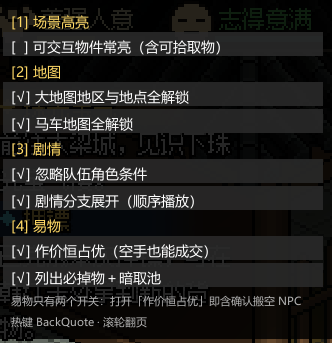

# WulinTweaks

**《大侠立志传》（Hero's Adventure: Road to Passion）微调套件**
场景高亮 / 大地图解锁 / 剧情条件放宽 / 剧情分支展开 / 剧情期间显真名 / 易物通吃

基于 BepInEx 6（IL2CPP）的 Harmony 插件。运行时按 `` ` `` 呼出面板，**所有开关默认关闭**（即原版行为），按需打开；面板上改动会立即写进 cfg，下次启动沿用上次状态。



---

## 功能

| # | 功能 | 默认 | 说明 |
|---|------|------|------|
| ① | **场景高亮** | 关 | 进入场景时扫描一次，给可交互物体加描边。跳过建筑本体（房子、城墙等只显示轮廓的物件）；地面物品只点亮可拾取的（`TempID > 0`），这一条恒开、不做开关 |
| ② | **大地图解锁** | 关 | 大地图所有地点默认可见、可直接前往；马车地图图标同样全部放开 |
| ③ | **剧情条件放宽** | 关 | 触发 Scenario 时忽略「队伍中必须存在某角色」的判定（人不在队也照演）。**含「结缘界面」的图跳过不放宽**（那类图收尾会写情缘/武功/buff，人不在队会写坏人物数据，见下节）；彩蛋类条件（图里点了别人的角色）只放宽、不动队伍；任何情况下都不动队伍 |
| ④ | **剧情分支展开** | 开 | 把「某角色是否在队」的互补分支（Negate=0/1 兄弟对）由 if/else 改成**顺序播放**：先播队内有该角色的那几段，再播队内没有时的兜底，最后汇合。**通用规则**（1.10.0 起不再限定某张图；跳过嵌套门对 / 无出口 / 两侧都不是单节点剧情的情形）—— 它只改剧情走线，不改变条件判定规则。接管方式是把门的 `HoldNode.CheckCondition` 整门判真（与手机端 v87 对齐） |
| ⑤ | **剧情期间显真名** | 跟随③ | 剧情对话期间把出场角色的名字从「陌生名」（如 `@冷峻严肃的中年人`）换成**熟悉后姓名**（`洛天雄`，即模板的姓+名）。只作用于当前正在播的那张剧情图；剧情收尾、换图、读档后还原。**1.11.8 起不再带称号**（试过两版都失败，见下文「剧情期间显真名」一节的回退记录） |
| ⑥ | **易物通吃** | 关 | 两个开关：「作价恒占优」与「列出必掉物＋暗取池」。**确认搬空 NPC 不再是独立开关**，跟随「作价恒占优」——打开它就一并生效（作价恒占优 / 空手也能确认 / 成交即搬空三件事一起）。拿走的池子物品会**同步从池子原件扣掉**，暗取/摸尸不会再拿到同一件 |

| ⑧ | **控制台 `join`** | 常开 | `join <人物ID\|人物名>`：入队 + 解除陌生（`初次见面=1`、好感 100、清陌生名）+ 可入家园（`CouldBackToFief` + 队友状态 + `UnlockInviting-<uid>`）；末尾加 `1` 再设为结缘（情缘武功 + buff）。已死亡角色先复活（`m_isAlive`）。**静默执行**：不往控制台/聊天栏写任何文字，只在 BepInEx 日志留痕 |

「高亮」只在**进入场景时扫描一次**，不做定时刷新，避免每帧遍历对象表。

---

## 剧情分支展开（通用规则）

原版剧情图里「某角色是否在队」的条件是**互补门对**（`Negate=0` / `Negate=1`），引擎按顺序问、
第一个满足的就被走 —— 也就是 if/else；讲解类剧情的出口直接连到汇合点，所以另一侧永远不播。

展开规则一句话：**把「在队侧」的出口改接到「不在队侧那道门」，再让两道门都判真。**

```
region = reach(G0) − reach(G1) − {G0, G1}     # 只有在队侧能到的节点 = 该侧独占内容
exits  = region 内指向 region 外的边（已指向 G1 的除外）
动作    = exits 全部改指 G1；G0、G1 在 HoldNode.CheckCondition 上判真
```

- **A 类**（一侧播放剧情 / 一侧直通）→ 变成梯子顺序展开
- **B 类**（两侧都是播放剧情）→ 先播在队那段，再播不在队那段
- 跳过：`region` 为空 / 过大 / 无对外出口、与另一对门的区域相交（嵌套门对）、
  `partnerID <= 0`、两侧都不是单节点剧情的 X 类
- 想排除某张图：配置项 `3_Story / FlattenBlacklist`（逗号分隔，支持 `*` 前缀）

离线预演（改代码前先看会怎么改）：

```powershell
python tools/scan_flattenable.py --json out.json      # 全量：哪些图有可展开门对
python tools/simulate_flatten.py --only R10049-2 --detail   # 单图：逐条列出会改哪些边
```

全量结果（1641 张剧情图）：692 张含门对，A 类 108 张可安全展开；A+B 199 张。

## 剧情期间显真名

对话期间把出场角色从「陌生时姓名」（`@冷峻严肃的中年人`）换成**熟悉后姓名**（`洛天雄`）——
落点是**角色实例的 `m_surName` / `m_givenName`**（显示层既不读 `FullName` 也不读模板）。

### 「称号·姓名」试过两版，都回退（1.11.8，别再走回头路）

| 版本 | 做法 | 结果 |
|---|---|---|
| 1.11.6 | getter 层：返回值换成 `RealFullNameWithTitle`（它确实带称号） | 日志打出了带称号的串，**画面仍是「洛天雄」** —— 显示层不看 getter 返回值 |
| 1.11.7 | 数据层：`m_surName=""`、`m_givenName="称号·姓+名"`（称号取模板 `PersonalTitle`，走 `GameUtil.GetLocTitle`） | PC **成功**（洛天雄 → 总捕头·洛天雄）；但 ① 没有 `GivenName` 的普通 NPC（大梁城知府/城门守卫）会拼成「大梁城·知府大梁城·知府」；② 手机端字段写对了却仍显示「洛天雄」，那处 UI 三条路（字段 / 气泡 Init / TMP set_text）都不走 |

结论：这条路要么改坏普通 NPC，要么手机上根本不生效，**收益不足以承担**，1.11.8 整体回退成「姓+名」。
将来若要做，得先定位手机端那个不认字段的显示出口（疑似 `TalkMessageNode.NpcName` 节点数据）。

> 顺带记下两个坑：① `GameCharacterInstance.Title` **不是称号**，返回的是「知府大梁城」「守卫大梁城」这种官职串（洛天雄是空）；② PC 的 interop 没导出 `CharacterPoolData.PersonalTitle`，只能走 `GameUtil.GetLocTitle(tpl)` 扩展方法。

窗口是事件驱动的：

| 时机 | 动作 |
|---|---|
| `StoryScenarioNode.OnActive`（**Prefix**） | 开窗并改写姓名；必须在原函数之前，否则气泡先用陌生名渲染一遍 |
| `StoryScenarioNode.Continue` | 只续期（实测节点间空档 1.8~19 秒，用短宽限判断"播完了"必然误还原） |
| `StoryCloseNode.OnResult`（`GraphName` 匹配） | 立刻还原 |
| `MapManager.OnLoadMapComplated` | 立刻还原（换图/读档兜底） |
| 播放期间每 500ms | 复查一次（游戏自己把名字写回去时会改回来） |

---


## ⚠️ 一个会关掉柳月樱线的坑

> **无名渡口与富商对话，剧情条件放宽会和诸葛神机前往海蛟帮，会变为「海蛟帮贵客」，导致柳月樱事件关闭。**

机制：开着「剧情条件放宽」时，海蛟帮支线 `M5030-0` 会比预想的更早推到底，给存档打上 `海蛟帮贵客` 标记。
而柳月樱引子图 `R10049-0` 的作废条件之一正是这条标记 —— 标记一旦存在，引子图立刻变 `Failed`，
`R10049-2`「护花使者」及之后整条线永久关闭。

**想走柳月樱线，就在九黎部落拾取社稷之印之前，先把大梁城城门口那场「帮忙解围」做掉。**

已经踩坑的话，收个临时开关关掉剧情放宽也救不回来（标记已经写进存档），只能读更早的档。

---

## 放宽的范围：结缘图跳过（1.11.19）

「忽略队伍角色条件」要的效果就是**人不在队也照演** —— 这是要保留的功能。
但有一类图不能这么干：**收尾会写人物数据**的结缘图。

| 结缘图（12 张，全在 `月老祠` map 5016）里的节点 | 写的是什么 | 人不在队时会怎样（反汇编核对，见下） |
|---|---|---|
| `结缘界面 partnerID` | 读 `UIBonds.Show(npcID)` 的立绘/名字 | 取不到实例 → 界面打开时空引用 |
| `激活NPC情缘`（`ChangeNpcAffectionNode`） | `GameCharacterInstance.bonds`（`SetBond` **双向写**） | 实例缺失会**补建永久实例**再写；但**每放宽一次就再配一次**，是语义问题不是空引用 |
| `获得武功或绝学`（`ChangeKungfuNode`） | 她的 `kungfuInstances`（「望穿秋水」，`isUnique=false`） | 实例缺失 → **静默 no-op**；实例在 → 可重复叠加 |
| `增减buff/debuff`（`ChangeBuffNode`） | 她的 `buffLib`（8901/8501） | 实例缺失 → 静默 no-op |
| `改变NPC关系值`（`ChangeNpcRelationNode`） | 她的 `relationShip` | 实例缺失会**补建永久实例**再写 → 不会"写到另一份实例" |

**2026-11-04 反汇编更正**：早期这里写的是「写到临时实例上 / 读档就丢 / 关系值分裂」——那是按
`GetOrCreateCharacter(uid, isPernament:false)` 的默认实参推测出来的，**已证伪**。节点实际传的是
`isPernament: true`（`ChangeNpcRelationNode` @`0x269AC20` 前 `mov w2,#1`），补建的是**永久**实例；
`获得武功/绝学`、`NPC背包物品` 这类则用 `GetCharacter`（取不建），实例缺失时整条动作直接 `return`。
也就是说：**没有"写进临时实例"这条路径**，真实代价是"静默丢失"或"补建实例"，不是数据分裂。

> 但**结缘图仍然必须不放宽** —— 理由从"写坏数据"变成"**语义重复**"：`激活NPC情缘` 会再配一次、
> `获得武功或绝学` 会再叠一份（`isUnique=false`），再叠加 `R{id}-` 图免压制、条件恒真反复触发，
> 每触发一次就是 `月老赐福 += 1`（`ChangeTagNumNode.mode: 0=增减`）、再叠一份功法。

`GameCharacterManager.GetCharacterByTempleteId` 返回的是 **HashSet**，
`GetOrCreateCharacter(uid, isPernament:false)` 确实会新建临时实例，
`SaveObjectGameCharacter.createdCharacter` 按 **instanceId** 索引——同一 uid 两份实例在引擎里合法。
这个"多实例余地"是真的，只是被审计的写类节点没走到那条路上去。

**规则（1.11.26 起）**：

| 图 | 放宽？ |
|---|---|
| `Guide10099-*`（师父线整族）、`Fame-2`、`R20004-6` | **不放宽**（正则 `^(Guide10099-\|Fame-2$\|R20004-6$)`） |
| 含「结缘界面」`ShowUIBondsNode` 的图（月老祠那 12 张） | **不放宽**（玩家不在队就不该播） |
| 本命图 `R{角色id}-*`，她**从未入队** | 不放宽 |
| 其余（含本命图、彩蛋图） | 放宽 —— **但每张图只放宽一次**（`RelaxOnce`），第二次起走原版 |
| 手动黑名单 | 不放宽 |

> 旧的「固定名单」HashSet 已删除（`R10112-2` 烈酒与故事 也随之移除，交给“每图一次”兜底；`R20004-6` 伙伴的故事按用户要求保留在正则里）。
> 这样“同一段剧情不会反复执行放宽”，比原来压 Hold 的 `times` 更贴近根因。

```
① 扫 graph.nodes，逐节点问 IL2CPP 类名 → 命中 ShowUIBondsNode 即结缘图（按图指针缓存，只扫一次）
② 扫不了（Il2CppNative 未就绪 / 异常）→ 退回 12 张已知图名表（R10008-5 … R20063-2）
③ 结缘图：return false（不放宽）→ 走原版「必须在队」；其余本命图：照常放宽，且不动队伍
```

效果对照：

| 图 | 她不在队时 |
|---|---|
| 结缘图（含 `结缘界面`） | 不触发（原版判定不过），不会半写人物数据 |
| 个人剧情等其它本命图 | **照演**（要的功能），队伍一个字节都不动 |

> 1.11.11–1.11.18 曾用「剧情开播时临时把人加进队、收尾再踢掉」当权宜补丁（`PartnerJoin`）。
> 它确实能让写入落到活实例上，但副作用是她会真的入过一次队（`IsJoinedTeamOnce` 置真），
> 而且改变了"人不在队也照演"的语义。**1.11.19 整个删掉了**，
> cfg `3_Story / JoinAbsentPartner` 也一并移除（老 cfg 里留着那行无害）。

### 「结缘图」是按什么认出来的（可复验）

| 层 | 依据 | 覆盖范围 |
|---|---|---|
| 运行时（主判据） | 拿 `graph.nodes` 逐个问 `il2cpp_class_get_name`，命中 `ShowUIBondsNode` 即结缘图（按图指针缓存，只扫一次） | 全量剧情，含 DLC/后续新增——**不依赖名单** |
| 兜底（扫不到时） | `TeamRule._knownBond` 写死的 12 张图名 | 仅当 `Il2CppNative` 未就绪/抛异常（日志 `扫图失败 → 退回图名表`） |

「结缘界面」这个编辑器节点名 = 运行时类 `ShowUIBondsNode`：`ModEditor.zip` 里该节点的
`m_Script` guid 指向 `ModShare.Runtime.dll`，字段只有 `SaveID` / `IsSaveNode` / `partnerID`
（`partnerID` 值恒等于图名里的角色 id）。

```powershell
python tools/find_bond_graphs.py            # 全 1804 张剧情图里含「结缘界面」的正好 12 张，与 _knownBond 一致
python tools/find_bond_graphs.py --all      # 各节点类型的命中图数（对比判据用）
```

> 为什么不用旁边的「激活NPC情缘」：它出现在 **24** 张图里（`R10005-10`、`R10028-7`、`R10049-11`
> 等正常线也有），拿它当判据会把能放宽的个人剧情一起排除；「结缘界面」正好只落在配了结缘 UI 的
> 12 张收尾图上，最精确。反过来 12 张结缘图**全部**含「激活NPC情缘」，两者是包含关系。

离线核对 12 张结缘图的形状：

```powershell
python tools/simulate_flatten.py --only R20025-11 --detail   # 门对 3，B 类 1，region=0 → 不改线
```

> 顺带记一笔：`R20025-11` 的门对 `region` 算出来是 0（两条分支都绕回同一个分派门），
> 所以「剧情分支展开」不会改这张图的走线——排查结缘问题时不用怀疑它。

---

## 剧情条件放宽的「固定名单」（不放宽）

规则本身是「条件是别人角色就放宽」（彩蛋思路），但有些剧情放宽后会演错，所以有两类名单：

| 名单 | 位置 | 作用 |
|---|---|---|
| 代码内固定名单 | `TeamRule._fixed`（手机 `k_fixed_original[]`） | 这些图**一律按原版判定**，与 cfg 无关 |
| 手动名单 | cfg `3_Story / IgnoreTeamConditionBlacklist` | 你自己加的排除项（支持 `*` 前缀与 `图名:partnerID` 门对级） |

**条目写法（1.11.35 起两种都支持）**：

| 写法 | 作用 |
|---|---|
| `R10049-0` | 整张图都不放宽 |
| `R10060-2-*` | 按前缀压一族图 |
| `R10049-10_0_0` | 场景键（自动归一到宿主图名 `R10049-10`） |
| **`Fame-10:10049`** | **门对级**：只压这张图里 `partnerID=10049` 的那几条在队条件，同图其它角色照常放宽 |

代码内固定名单当前内容：`Fame-2`、`Guide10099-1/6/11/13/15/16/18`（师父线）；
**`R10112-2`（烈酒与故事）已于 2026-10-31 移出**（它的开启条件只有「大地图图标 5064 冰心湖已显示」，
改真解锁后不需要再压），
以及 2026-10-23 追加的：

- **`R20004-6`** —— 伙伴的故事 / 包打听(20004)。图里对花四娘(20025)的「需要伙伴」属于「别的角色」，
  按彩蛋规则必放宽；而图里有 3 个 `ChangePartnerNode(state=1, partnerID=20004)` = 把包打听踢出队。
  放宽后这段在不该播的时候播了（表现为「与花四娘结缘后、同时带着包打听，包打听忽然离队」）。

> 曾把主线「楚襄兵祸」(`Fame-6`) 也加进来，实测没有必要，1.11.10 已撤销。

要再压某张图：图名就是剧情资产名（`Story/*.asset` 的文件名，例如 `R20004-6`），
手工名单里加一行重启即可；离线查事件分组用 `事件总表.xlsx`（`StoryConfig` 表，`子事件` 列是逗号分隔的图名）。

---

## 1.11.34 / 1.11.35 备忘

| 版本 | 改动 |
| **1.11.43** | ① `BranchFlatten` **删除“region 相交则两对都跳过”**，改为只统计；② 新增 `Patch_StoryPlayAlone`：运行期扫描类型名含 `Alone` 且有无参 `OnActive` 的类型并挂 Prefix 打 `[play]` 日志（找不到则回退按 `WuLin.StateMachine.StoryOpenAloneNode` / `StoryHeadAloneNode` 找）；纯观测。③ 版本号常量修正为真实版本（此前 1.11.40–1.11.42 的 dll 一直自称 1.11.39，导致日志头不可用于判版） |
| **1.11.42** | **只加诊断日志，不改逻辑**：`HoldOnceGuard` 的 `[once]` 行补上 `门=<指针> name=<节点名> times= hits=before→after flatGate=Y/N`，上限 8→60。另：分支展开日志上限 40→200、逐对日志 60→300（1.11.41） |
| **1.11.40** | **收敛成一句话：随剧情条件放宽一起做 clear(pid)。** ① `Unstranger.Apply(pid)` 从 `NativeTeamHook.MarkRelaxed` 移到 `TeamRule.Compute`，位置在「黑名单 / 场景名单 / 结缘图 / 未入队」等守卫**之后**、`RelaxOnce` **之前** —— `RelaxOnce` 只该限制放宽，不该限制清名字。② `RelaxName.Sync()` 停用（不再写模板真名/不再还原）。现在 mod 只做「清 @」，显示完全交回游戏 |
| **1.11.39** | **删除回落机制**：① 不再注册 `Patch_RealName` 三层 getter 补丁（`get_FullName` / `get_FullNameWithTitle` / `get_IsUsingStangerName`），显示交回游戏；② `RealNamesOf` 去掉 `inst.RealFullName` 拆分回落，只取模板 `SurName`/`GivenName`；③ `Unstranger` 只清 `m_givenName` 的 `@` |
|---|---|
| **1.11.34** | 新增 `Unstranger`：**放宽「某角色在队」这条条件时，把条件涉及的那个 `partnerID` 从「陌生名」改回真名**。范围就是这个 pid —— 不全档扫、不按名单；触发点挂在 `NativeTeamHook.MarkRelaxed`（Negate=0 那一侧被跳过时）。只改 `m_surName`/`m_givenName` 两个 string 字段，不动 `relationShip` / `m_additionProps` / 任何字典结构；换图/读档清缓存重判 |
| **1.11.35** | 放宽名单（`IgnoreTeamConditionBlacklist`）支持 **`图名:partnerID` 门对级**（与 `FlattenBlacklist` 同一套语法），并把「剧情分支展开跳过名单」里的两个场景一并压掉：`R10049-10:10049`、`Fame-10:10049` |
| **1.11.36** | 修「陌生名偶尔不生效」：① 不再把「此刻不是 `@` 名」缓存成「以后也不会陌生」（`@` 是在角色初始化时才写进实例的，放宽判定常早于那一刻）；② `StoryScenarioNode.OnActive` 里 `Unstranger.OnPlay(graph)` 按「本图被放宽过的 uid」补一次，排在 `RelaxName.PlayBegin` **之前**（先清 `@`，`RelaxName` 拍到的原值才是空串，收尾还原后仍回落到模板真名） |
| **1.11.38** | **简化**：放宽在队条件触发时，对该 `partnerID` 的实例只做一件事 —— 清空 `m_givenName` 里 `@` 及其后面的内容（`m_surName` 仅在它本身也以 `@` 开头时才清，正常情况它是空串、不要动）。不再查模板/写模板真名 |
| **1.11.37** | 修「读档后再触发同一段剧情，陌生名不生效」：挂 `GameCharacterManager.OnLoadFinished` → `TeamRule.Reset()`（清 `_relaxedOnce` / 判定缓存 / 结缘图扫描）+ `Unstranger.Reset()` + `RelaxName.DropAll()`（**只丢槽位不回写**，读档后旧实例已作废）。不清 `_relaxedOnce` 的话，读档后同一张图会被判「已放宽过一次 → 走原版」，`MarkRelaxed`/`Unstranger` 一次都不被调用。另：`OnPlay` 走 `Apply(uid, force:true)` 忽略缓存 |

> **为什么要门对级**：`Fame-10`（红颜劫）一张图里有 **30 多个 partnerID**
> （10005/10008/10009/10021/…/42002），写成图名级会把整张图的放宽全压掉；
> 而 `R10049-10` 里只有 `10049`，两种写法等价（实测 `partnerID` 集合 = `{10049}`）。
>
> **陌生名为什么"清空"就能显示真名**（反汇编 `libil2cpp.so`）：
> `get_IsUsingStangerName(0x223B8AC)` = `m_givenName` 非空且以 `@` 开头；
> `get_FullName(0x223B950)` 在"不陌生"分支读实例 `m_surName + m_givenName`，空则回落模板。
> 所以把 `@…` 清掉、名字留空即可让 PC 回落到模板 `surName+givenName`。
> ⚠️ **手机端不成立**：手机回落的是 `CharacterPoolData.uName`，清空会退化成内部名，
> 所以手机端改成"直接写模板真名"并丢弃该 uid 的临时改名槽（v139/v140）。

---

## 1.11.27 / 1.11.30–1.11.31 备忘

| 版本 | 改动 |
|---|---|
| **1.11.27** | 修 `NativeTeamHook.Dispatch` 没检查总开关：配置里关掉「忽略队伍角色条件」后，`RelaxName`/`HoldOnceGuard`/`Patch_ChangePartner` 都被挡住，唯独这一层仍在用基类实现顶替原版判定。现在开关关闭即直接走原版。（`BranchFlatten.Try` 仍在 gate 之前，它有自己的开关） |
| **1.11.30** | 地图三合一：新增 `Plugin.MapMaster = UnlockWorldMap || UnlockCabMap`，`IsPassIcon` / 马车 `Update` / `MapTrueUnlock` 都改用它 |
| **1.11.31** | 面板合并：去掉「马车地图全解锁」独立行，改为一行「地图解锁（大地图＋马车＋存档）」，拨动即同时设两个开关并 `MapTrueUnlock.Reset()` |

> 手机端 v130/v131 と同じ「真解锁」：`MapTrueUnlock` 会反射找 `SaveObjectMapManager`，
> 把 343 个地点 id 写进 `listShowIcon`。手机端因为不能安全调泛型 `List.Add`，
> 改成整份重建 `_items` 数组，细节见 `wulin-apk/README.md`。

## 大地图「真解锁」（1.11.29）

从 1.9.x 起，「大地图地区与地点全解锁」只改**显示层**：Harmony 把
`UIWorldMapManager.IsMapEnable` 判真、`UIWorldMap.SetCityVisible` 强制 `isShow=true`、
再把 `CityIcon` 子节点 `SetActive(true)` —— 存档里的 `SaveObjectMapManager.listShowIcon` 一直没变。

而剧情节点「判断大地图图标显示 mapID=X」读的正是那份**存档数据**，于是会出现
「图标看着是亮的，剧情门永远判不过」的死循环（曼陀罗 `R10021-4` 卡玉门关 5059、
`M2221-12`「问路」卡炎城 20400 就是这么来的）。

1.11.29 起改成真写：`MapTrueUnlock.cs` 在 `MapManager.OnLoadMapComplated` 之后，
把「大地图可显示的地点图标」全集（`LocData` 里全部 `WMapName_<id>`，**343 个**）
逐个 `Add` 进 `listShowIcon`；取存档对象用反射按类型名找（`UIWorldMapManager` /
`MapManager` 里搜 `SaveObjectMapManager`），成员名取 `listShowIcon`，找不到就记一条日志跳过。
游戏一存盘就是永久解锁。

开关仍是 `2_WorldMap / UnlockAll`：打开＝真解锁 + 显示层补丁；关掉＝什么都不做。
日志：`[map] 大地图真解锁：listShowIcon +N（目标 343 个）`。

> 注意：真解锁之后，所有 `Negate=1`（要求「该图标未显示」）的剧情分支都会判假。
> 这是"真解锁"的固有代价，不是 bug。

## 家园可入：`FiefReadyList`（1.11.28）

**问题**：10142、10143 这类角色 `join` 之后仍放不进家园；而且「可入家园」改完当次有效、重启就没了。

**为什么不能写进存档**：家园判定读的是 `CharacterTeamMemberExtendData.CouldBackToFief`（偏移 `0x50`），
而 `CharacterTeamMemberExtendData` 是 `SerializedScriptableObject` **配置表**，不属于任何 `SaveObject` ——
Save0 的 16 个 `.save` 全搜过，`couldBackToFief` 出现 **0 次**。它是天生内存态的。

三件套里另外两件本来就是存档数据（写一次就留住）：

| # | 条件 | 落在哪 |
|---|---|---|
| ① | `CharacterTeamMemberExtendData.CouldBackToFief` | **运行时配置**（每次启动都得补） |
| ② | `m_TeamMemberState.leaveTeamMap/Pos/Dir` | 存档 |
| ③ | 故事标签 `UnlockInviting-<uid>` | 存档 `TagString` |

而 10140–10145 连 `CharacterPoolData` 里都没有（DLC 角色），CTMED 表只有 90 行（本体伙伴），
`GetData(uid)` 必然 null —— 光靠 `join` 给的那次内存态，一重启就回到进不去。

**做法**：cfg 增加白名单，每次读档/换图后自动补一遍，效果等于持久。

```ini
[3_Story]
FiefReadyList = 10142,10143
```

- 实现：`FiefAuto.cs`，挂在 `MapManager.OnLoadMapComplated` 之后（`Hooks.MapLoaded`）；
- 对每个 uid 调 `PartnerTools.FiefReady()` —— 有行就置真，没行就 `AddData` 造行；
- 只补「已经当过队友」的（`TeamMemberState != null`），其余等入队后再补（最多重试 60 次）；
- 日志：`[fief] 白名单 2 个：10142,10143` → `[fief] 家园可入补完：2/2`。

手机端 v124 是同一套逻辑的 native 版（还多一步「取配置对象要走
`BaseDataClass.GetGameDataInternal`，因为它类在 `GameData` 命名空间、且 `FindObjectOfType` 摸不到」），
细节见 `wulin-apk/README.md` 的「家园可入」一节。

---

## 水域 / 入水机制（技术归档，2026-10-25）

> 起因：用户发现「PC 上女角色进华清泉(504)会走进水池，手机端不会」。这一节是查完的结论，
> 代码侧不改任何东西，只留档，免得以后重走一遍。

### 1. 水域格从哪来

地图 prefab 里单独一层 `_SwimGrid`（Tilemap）定义「哪些格是水域」。PC 的
`map_assets_all.bundle` 里实测只有这几份数据：

| 对象 | 格数 | 范围 |
|---|---|---|
| `_SwimGrid`（Map_504） | 760 | x 12~80，y 18~43 与 y 85~100（两个池子） |
| `_SwimGrid`（2160） | 177 | x 63~80，y 85~100（就是 504 第二个池子） |
| `_SwimLadder` | 8 / 2 | 上岸点 |

> 手机端：**原版 APK 的地图 prefab 里也有这两层**（`assets/aa/Android/prefabs_map_assets_assets/_artwork/map/prefab/map_504.prefab.bundle`
> 里 `_SwimGrid` = 760 格、`_SwimLadder` = 8 格；map_2160 = 177 / 2 格），与 PC 逐格一致。
> 但早期设备探针曾看到「运行期地图实例没有这两个图层」，两者是否矛盾要靠 v112/v113 的运行期日志
> （`[water] ME.IsSwimGrid(x,y) 原值=…`）来定：出现 `原值=1` 就说明原版手机本来就认水域格。

官方 mod 编辑器文档原话：**「温泉场景实际有单独的一个地格图层控制地格属性，只有地图编辑器配置了的地格
才算作水域……并不是玩家看到是水的地方就是水域。」**

### 2. 判定链（PC / 手机同构）

`Role.CheckInBathWater(Nullable<Vector3Int> tile)`：

```
cell = tile ?? WorldToCell(transform.position)   // 不传就用脚下格
swim = MapManager.IsSwimGrid(cell)               // → MapEntity.IsSwimGrid → 查 _SwimGrid
if (是玩家) RoamingManager.SetInBath(swim)
if (swim == Role.IsInBath) return                // 幂等：站着不动不会被重复补
Role.IsInBath = swim; GameCharacterInstance.SetBathing(swim)
if (swim) GameUtil.CreateRoleGhost(role)         // 水中倒影
Animator.SetFloat("IsBath", swim ? 1 : 0); 影子隐藏; 移速 = CharMoveSpeedInWater(0.5×)
```

**判据只有「格子在不在 `_SwimGrid` 里」** —— 不看角色 id、不看性别、不看形象。

调用点只有这 5 类，注意**站着不动不会有任何调用**：

| 调用点 | 传的格 |
|---|---|
| `Role.OnMove` | 不传（脚下格），每走一格一次 |
| `CreateRoleMar.CreateNpc` / `CreatePlayer` | 出生格 |
| 剧情 `MoveNodeOnPlay` / `MoveNodeSkip` | 目标格 |
| `JumpToDestinationNodeOnPlay` | 目标格 |
| `ChangeNpcDestinationNode.OnResult` | 目标格 |

### 3. 「能入水」≠「像在游泳」

游泳的观感由**形象资源**决定（`chara_assets_all.bundle` 实测，命名规律）：

- 动作：`{B|Z}{形象}_Wash*`，例如 `B178_WashStand1` / `B178_WashMove1` —— 共 **160 条，覆盖 78 个形象**
- 贴图集：`{形象}w`，例如 `178w` / `100w` —— 共 **40 套**
- animator 的 `runtimeAnimatorController.name` 就是形象 id（叶银瓶 178 / 玩家 100 / 叶云 177），类型是
  `AnimatorOverrideController`，base 都叫 `Character`

**没有 `{形象}w` + `Wash*` 的角色**：入水状态照样给全（`IsBath=1`、移速 0.5×、倒影、影子隐藏），
但动画只能继续播 `stand/walk` → 看起来就是「站在水面上走」。

实测对照（同一张 504）：

| 角色 | 形象 | 正在播 clip | 贴图集 |
|---|---|---|---|
| 10009 叶银瓶 | 178 | `B178_WashStand1` / `B178_WashMove1` | `178w` |
| 100401 玩家 | 100 | `B100_WashStand1` / `Z100_WashMove1` | `100w` |
| 10033 叶云 | 177 | `B177_stand1` / `B177_walk` | `177`（无 w） |

离线核对：177 既不在 78 个 Wash 形象里，也没有 `177w` 图集 —— 所以「随机路人也能游、她怎么都不游」
完全是形象资源的有无，不是名单。

### 4. `ForceNPCSwim`（`GameEnvConstStrData`）

- 表里名称 `ForceNPCSwim`，**官方值为空**（名称即开关）；
- 进入水域图时游戏用 `GameConfig.GetConfigStr("ForceNPCSwim")` 读它（是 `GetConfigStr`，不是 `...Array`）；
- 把 id 填进去（或运行时替换返回值）→ **该 NPC 的落点被放进水域格**。实测：叶云 10033 从 `(36,17)`
  陆地变成 `(21,32)` 水域格。**它只改落点，不管入水状态和动作。**


### 手机端的落地结论（2026-10-26，v112~v123）

同一套判定在手机上也成立，但「把 NPC 放进水里」要绕开几个坑（详见 `wulin-apk/README.md` 的对应章节）：

- 手机端**不读** `ForceNPCSwim`（PC 读，手机零调用）；
- `CreateRoleMar.CreateNpc` 有 8 个参数，改它的入参会闪退；
- `GameCharacterInstance.SetPos` / `SetMapId` 的**内联钩子构造失败**，改不了；
- `SetPos` 只改实例数据，画面上的 `Role` 不动 → 必须用 **`Role.NpcTP(Vector3Int)`** 真传送；
- 进水里之后**静止播 `WashStand1`（泡水坐姿）、走动才播 `WashMove1`（游泳）**——PC 与手机动作/贴图集完全一致，所谓「手机版把水中资源改了」不成立。

### 5. 复现用的离线工具（`tools/`）

`dump_swimgrid.py`（读 prefab 的 `_SwimGrid`）、`dump_map_tree.py`（prefab 层级）、
`dump_animctrl.py` / `dump_animoverride.py`（animator 与形象覆盖）、`dump_npc_path.py`（`MapNpcPathData` 点位表）、
`dump_story_nodes.py` / `node_types.py`（剧情节点与节点类型字段表）、
`x64callers.py` / `x64lits.py` / `x64strings.py`（GameAssembly 反汇编辅助）、`xls_dump.py`（数据表）。

---

## 安装

1. 安装 [BepInEx 6.0.0-be](https://github.com/BepInEx/BepInEx/releases)（**x64 / IL2CPP** 版）到游戏根目录，先启动一次游戏，让 BepInEx 生成 `BepInEx/interop/`
2. 从 [Releases](../../releases) 下载 `WulinTweaks.dll`，放进 `BepInEx/plugins/`
3. 启动游戏 → 读取存档 → 按 `` ` `` 呼出面板

插件自包含：**除 BepInEx 本体外不依赖任何第三方库**（不使用 UniverseLib，UI 为自建 UGUI）。

配置文件 `BepInEx/config/wulin.tweaks.cfg` 首次启动时自动生成；
池子台账在 `BepInEx/config/WulinTweaks/trade-taken.txt`。

### 从源码构建

```powershell
cd WulinTweaks
dotnet build -c Release -p:GameDir="D:\path\to\WulinSH"
# 产物：bin\Release\WulinTweaks.dll → 复制到 <游戏>\BepInEx\plugins\
```

`GameDir` 三种给法，优先级从高到低：

1. 命令行 `-p:GameDir="..."`；
2. 在 `WulinTweaks/` 下放一个 `local.props`（已 gitignore）：
   `<Project><PropertyGroup><GameDir>D:\path\to\WulinSH</GameDir></PropertyGroup></Project>`；
3. 都不给则用默认的 `C:\Program Files (x86)\Steam\steamapps\common\WulinSH`。

编译依赖游戏的 `BepInEx/core/*.dll` 与 `BepInEx/interop/*.dll`（先启动一次游戏让 BepInEx 生成 interop）。

---

## 使用

进存档后按 `` ` ``（反引号，Tab 键上方）呼出面板，点击条目切换开 / 关；内容超出时用滚轮翻页。

| 配置项 | 分组 | 键 | 默认值 |
|---|---|---|---|
| 呼出键 | `0_UI` | `ToggleKey` | `BackQuote` |
| 场景高亮 | `1_Highlight` | `AlwaysHighlight` | `false` |
| 跳过建筑本体 | `1_Highlight` | `ExcludeBuildings` | `true` |
| 大地图全解锁 | `2_WorldMap` | `UnlockAll` | `false` |
| 马车地图解锁 | `2_WorldMap` | `UnlockCabMap` | `false` |
| 放宽剧情角色条件 | `3_Story` | `IgnoreTeamMemberCondition` | `false` |

| 易物作价恒占优（含确认搬空） | `4_Trade` | `AlwaysWin` | `false` |
| 易物列出必掉物＋暗取池 | `4_Trade` | `Pools` | `false` |
| 剧情诊断日志 | `5_Diag` | `StoryDiagnostics` | `false` |

`ToggleKey` 支持 BepInEx 的按键名（`BackQuote` / `F9` / `LeftControl` 等）。游戏内 `F8` 已被占用，故默认用反引号。

面板与配置项是同一份状态：面板上点了什么，cfg 里就写什么（点击后立即 `Config.Save()`），反之亦然。

两个易物开关的分工：

- **`AlwaysWin`** — 易物「通吃」总开关，一个开关管三件事：`ValueOffset()` 恒 `>= 0`（NPC 必接受）、`playerTradingZone.GetTotalValue()` 为空时的 0 兜底成 1（空手也能确认）、以及成交后把交易区残留和 NPC 背包剩余一起搬进队伍背包（**确认搬空**）。前两道正是 `ConfirmTrading` 的内部门槛，第三道是同一个动作的收尾，分开没意义，所以 **1.11.5 起「确认搬空」不再是独立开关**，原来的 `4_Trade / TakeAllOnConfirm` 已移除（老 cfg 里那一行不会再被读写，留着也不影响）。
- **`Pools`** — 只影响易物：打开后 NPC 侧额外列出「击杀必掉物」与「暗取池」的内容（池子里有的 + 模板里有但池子没填的）。**这是纯显示**：副本只写进 `npc.BackPack`，`stealBackPack` / `dropOnDeadBackPack` 一个字节都不动，所以暗取能偷到什么、打死掉什么完全不受影响。

`1_Highlight / ExcludeBuildings`（跳过建筑本体）默认仍为 `true`：它不是功能开关，而是高亮打开后的过滤条件，关掉会把整栋房子描边。

---

## 易物 / 暗取是怎么被改的

游戏里一个 NPC 有三份物品容器：

```
CharacterPoolData（策划表，模板）
    Items             ItemsDropOnKill      StealPool
        │                   │                 │
        ▼                   ▼                 ▼
GameCharacterInstance（运行时角色实例）
    backPack (0x140)  dropOnDeadBackPack (0x148)  stealBackPack (0x150)
        │                                           │
        │  易物 NPC 侧显示这个                       │  暗取读这个
        ▼                                           ▼
    易物面板                                     暗取面板
```

实测（慧元）：`dropOnDeadBackPack` / `stealBackPack` 运行时是**空的**，而模板里 `tplSteal=1` —— 游戏没把模板实例化进去。暗取只认运行时包（`StealManager.OnStealSuccess` 0x43E2C0：取 `[char+0x150]`，件数为 0 就跳走）。

`Pools` 开关做的是**复制 + 拿走时扣池**：

1. 把「池子里现有的实物 + 模板里有但池子没填的条目」各复制一份放进 `npc.BackPack`，让易物面板列出来、能拖走；
2. 副本被真的拿走（成交/搬空后进了队伍背包）→ 按拿走数量从 `stealBackPack` / `dropOnDeadBackPack` 里 `RemoveItem` 掉同样多；
3. 于是「易物换了一份，暗取还能再偷一份」这个漏洞被补上——原件少了，暗取就没货。

> v1.0 只复制不扣池，`stealBackPack` 一个字节都不动，同一件能拿两次；**v1.1 起改为扣池**（`TradeKit.PoolDeduct`）。
> **1.11.3 起搬运改走合并版 `AddItem`**（修同类物品被搬成多堆），**1.11.4 起池子副本改为合并进同类堆 + 数量记账**（不再跳过背包已有的同类，池子内容不遗漏）。

三处细节值得说明：

1. **副本按物品 id 记账**，记在 `BepInEx/config/WulinTweaks/trade-taken.txt`（键为 `TempleteUid:InstanceId:池:物品id`）。只有「池子里这件被扣干」才记账（模板条目没有实物可扣，仍一次记掉）；取消交易不记，所以下次还能看到。不记账的话每次开易物都会再造一份，等于无限复制。
2. **扣池按差值算**：造副本时记下数量 `Stack0`，成交后副本剩余 `Stack`，差值就是玩家实际拿走的数量，只扣这么多——玩家只取一部分时，池子里剩下的还在，下次开面板会把剩下的再补上。
3. **副本有两种形态**：`npc.BackPack` 里**没有**同 ID 的堆 → 独立实例（按实例删、按 `Stack` 差记账）；**已有**同 ID 的堆 → 合并进那一堆（按数量删、按 `(原数量+副本量)−剩余` 记账，撤副本时只撤我们加的部分，绝不碰 NPC 原货）。合并形态是为了让池子里的东西不因为「背包已有同类」而从易物面板漏掉，同时面板不会出现两个同 ID 堆。
4. **副本在交易结束时清掉**：取消走 `CleanupCopies`，成交走搬空后的统一清理；异常关闭的残留由下次 `StartTrading` 的 Prefix 兜底。开面板与搬空后还会各跑一次 `MergeDupPiles`，把老存档里已被拆开的同类堆并回一堆。
5. **搬物品必须新建实例**。`GameItemPack.RemoveItem` 会就地做 `gii.Stack -= count`，而 `AddItem` / `AddItemAsIndependent` 以 `Stack > 0` 为前置条件。把同一个实例「加进目标包、再从源包删掉」会让两边都变成 `Stack == 0` 的空壳——表现为「源包清了、目标包什么都没有」。所以搬运一律 `new GameItemInstance(id, stack, 0)` 进目标包，再删原件。
6. **搬运必须用 `AddItem`，不能用 `AddItemAsIndependent`**。反汇编 `GameItemPack`：`AddItem` 对可堆叠物品会遍历 `Contents` 找同 `ItemData` 的堆并 `m_stack += count`（合并），而 `AddItemAsIndependent` 只做 `Contents.Add`（永不合并）。用后者搬几次就是几堆——这就是「易物搬空后队伍背包里金疮药分三四堆」的根因（1.11.3 修）。`AddItemAsIndependent` 只留给「背包里没有同类、必须按实例删掉的显示副本」。
7. **克隆的 `craftLevel` 必须传 `0`**。`GameItemInstance..ctor(id, stack, craftLevel)` 在 `craftLevel != 0` 时会调 `CreateForgeModify` 给可锻造装备滚一份随机附加属性（`IsStackable` 也靠 `modifyData == null` 判定）。原件本来就带 `ItemModifyData` 就直接共用同一份。

---

## 实现原理

游戏为 Unity **2020.3.13f1c1** + **IL2CPP**（x86-64）。用 Il2CppDumper 导出 `dump.cs` 定位类型与 RVA，再分别处理：

- **高亮** — Harmony patch `InteractiveObject.SetOutLine`。判定条件为 `clickType > 0`（`clickType == 0` 的是火把、凳子、桌子、灯笼、地板这类纯装饰），并按 `buildingType` 位掩码跳过建筑本体。
- **地图** — patch `UIWorldMapManager.Update` / `IsMapEnable` / `UIWorldMap.SetCityVisible`，以及 `UICabMapManager.IsPassIcon` / `UpdateIconShow`。地图图标节点的名字就是 mapID，遍历后逐个 `SetActive(true)`。
- **剧情** — `IsJoinedTeamCondition` / `HavePartnerCondition` 的 `CheckAllConnectNode` 在 IL2CPP 互操作程序集里没有导出，只能走机器码。读取 `GameAssembly.dll` 基址后按 RVA 写入 `E9 rel32`，直接跳到基类 `ConditionNode.CheckAllConnectNode`：跳过「角色是否在队」的委托判定，但保留前置条件链的递归遍历。原始字节会先保存，关闭开关时写回。
- **UI** — 自建 UGUI（`Canvas` ScreenSpaceOverlay + `CanvasScaler` 1920×1080 + `RectMask2D` 裁切 + 滚轮滚动），由 `RoamingManager.Update` 的 Harmony postfix 驱动，因此不需要注入 MonoBehaviour（IL2CPP 下注入的 `Update` 不会被执行）。
- **易物** — 反汇编 `TradingWithNpcManager` 得到真实流程：`StartTrading` 新建两个 `GameItemPack` 交易区并调 `TradingWithNpcUI.Init`；`MoveItem` 的源包是**按 PackType 写死**的（`Npc` → `npc.BackPack`），不是看物品在哪个包，所以只做显示层合并会导致点击拾取失败。`ConfirmTrading` 有两道门槛（见上），过了才 `npcTradingZone.MergeInto(TeamInventory)`、`playerTradingZone.MergeInto(npc.BackPack)`。确认之后插件再把交易区残留 + NPC 背包剩余一并搬进队伍背包。

安全性上，机器码 patch 前会校验入口 5 字节为 `48 89 5C 24 08`（`mov [rsp+8], rbx`，恰好一条完整指令），不匹配就放弃并打日志——游戏更新后不会写坏代码段。

### 对话闪退：Hold 空转引起的原生栈溢出

放宽「队友在队 / 有伙伴」之后，有些剧情图里的 `Hold` 节点会立刻满足，于是
`StoryManager.ContinueArrange` ↔ `HoldNode.OnActive` 在同一帧里互相递归，几千层后栈打穿。
现场证据（Windows 事件日志 `Application Error` id=1000）：

```
错误模块: GameAssembly.dll
异常代码: 0xc00000fd      # STATUS_STACK_OVERFLOW
```

因为是原生栈溢出，`Player.log` 里不会留下任何托管异常，表现为「对话到一半游戏直接消失」。

现在在 `StoryManager.ContinueArrange` 上挂了一个按**同一帧调用深度**的看门狗：超过 16 层就跳过这一层推进；
跨帧自动清零，所以卡住的那一帧下一帧会继续，不会把进度永久堵死。只在
`IgnoreTeamMemberCondition` 打开时生效，关掉时行为完全不变。触发的前 5 次会写日志：

```
[WulinTweaks] ContinueArrange 同帧已递归 16 层，阻断这一层
```

> 注意：`ContinueArrange` 的 Harmony patch 与机器码 patch 是两套机制，互不影响。
> 前者是托管层 prefix，后者改的是条件节点入口字节。

### 剧情反复触发：Hold 的「已成功」标志没人读

放宽之后还有第二个症状：同一段剧情反复播。

`HoldNode` 本来有 `checkSucessTimes`（`self+0x70`）作为「这个 Hold 已经成功过」的标志，
`addTimes()` 置 1、`clearTimes()` 置 0。但 `CheckCondition()` 根本不读它——反汇编确认它只做
`conditionPort.GetConnections()` → 逐个 `CheckAllConnectNode(io=1, line=null)`。
原版靠「条件为假」来实现一次性；条件被放宽成恒真之后，标志照常被置 1，结果却依然是 `true`。

诊断日志里同一个 Hold 的三次对比：

```
[diag] Hold "流程判断" ...  times=0 result=true    ← 第一次，该放行
[diag] Hold "流程判断" ...  times=1 result=true    ← 已经成功过，还在放行 ← 问题在这
[diag] Hold "流程判断" ...  times=1 result=false   ← 原版本来就会挡住的
```

对策是 `HoldOnceGuard`（同样挂在 `HoldNode.CheckCondition`）：`times` 非 0 的 Hold，
若这次仍被判为「可继续」，就把结果压回 `false`。每个 Hold 只可能因为放宽而通过一次；
游戏若用 `clearTimes()` 归零，之后还能再过一次，语义与原版一致。

```
[once] Hold "流程判断" times=1 已经通过过，压制本次继续（避免剧情重复触发）
```

> 实测 `frameHits` 恒为 1，说明重复触发**不是**同帧空转，与上面那条栈溢出是两条独立路径，
> 两个 guard 各管一段，不重叠。

### 排查开关

`5_Diag / StoryDiagnostics`（默认 `false`）会把每个 `Hold` 的条件检查结果、
`checkSucessTimes`、同帧重复次数写进日志（带采样：每个 Hold 前 5 次 + 之后每 50 次，
同帧重复 ≥5 次的一律记录），不会刷屏。只在排查剧情问题时打开。

---

## 工具（`tools/`）

| 脚本 | 用途 |
|---|---|
| `inspect_story_pc.py` | 读 `ModEditor.zip` 里的剧情图 YAML：核对展开规格、打印门梯、按 `partnerID` 查角色 |
| `scan_flattenable.py` | 全量扫描全部剧情图，按 A/B 类门对筛出「能展开哪些图」，`--detail` 直接吐参数表 |
| `simulate_flatten.py` | 通用规则离线模拟：列出会改哪些边、region 大小、风险（重叠/无出口/成环/终点丢失） |
| `mkmap.py` | 从 Il2CppDumper 的 `dump.cs` 生成 RVA → `Namespace.Type::Method` 映射 |
| `x64dis.py` | 按 RVA 反汇编 `GameAssembly.dll`（带符号注释） |
| `offscan.py` | 扫 PE 里 `[reg+disp32]` 访问某个结构体偏移的指令，定位读该字段的函数 |
| `audit_node_instances.py` | **（2026-11-04）** 反汇编 54 个 `*OnResultAction`，逐个判定「按 id 分支」用哪个取实例 API（`GetCharacter` / `GetOrCreateCharacter` + `isPernament` 实参）→ 得出「实例缺失时是静默 no-op 还是补建实例」 |
| `audit_flatten_side.py` | 全量剧情图 → 哪些门对会被展平、`region` 里出现哪些节点名；统计展平实际会播出多少写操作 |
| `audit_region_writes.py` | 在队侧 `region` 里写操作节点的 `mode` 分布（按 id / 按队位 / 全队），用来确认有没有「Index 指到别人」的风险 |
| `map_node_names.py` | 编辑器中文默认名 → 运行时类名（按序列化字段签名 + IDF 打分，输出命中字段与次优候选，可 `--detail` 核对） |
| `autodeploy.ps1` | 等游戏退出后把 `bin\Release\WulinTweaks.dll` 拷到插件目录 |

> 后四个需要 `wulin-apk/dumpout-intl/dump.cs` 与 `libil2cpp_intl.so`（安卓 intl 版 IL2CPP dump）。
> **它们的反汇编是安卓版的**，PC 的 `Assembly-CSharp.dll` 没在本机核对过（两边字段布局有差异，
> 例如 `ChangePartnerNode.partnerID` PC 是 `0x48`、手机是 `0x70`）。

---

## 放宽 / 展平的作用面（2026-11-04 离线审计）

问题：放宽和展平都会让「某人是否在队」的在队侧内容在**人不在队**时播出来。那些按人物 id 操作的节点会怎样？

**54 个 `*OnResultAction` 反汇编后只有三种**（脚本：`audit_node_instances.py`）：

| 档 | 取实例方式 | 实例缺失时 |
|---|---|---|
| A（13 个） | `GetCharacter(pid)` 取不建 | **整条动作静默 no-op**（武功/背包/钱/势力/经验/HP/buff/属性/形象/`伙伴邀请或离队`）。不写脏数据、不崩、不卡 |
| B（4 个） | `GetOrCreateCharacter(pid, isPernament:**true**)` | 补建**永久**实例再写（关系值 / 好感·激活情缘 / 强制死亡 / 修改位置）→ 与原版等价 |
| C（34 个） | 不碰具体人物 | 玩家侧 / 势力侧 / 地图侧 / 标记侧 |

**展平实际会播出多少**（脚本：`audit_flatten_side.py`）：全量 1804 张图里，692 张有门对、共 1652 个门对，
其中**会被改线的 902 个**（覆盖 1978 个节点、79 张图）；`region` 空或过大 501 个、无对外出口 249 个。
这 1978 个节点里：改变NPC关系值 119、**伙伴邀请或离队 115（全部 `state=1`=离队）**、增减buff 26、
改变角色属性 11、强制NPC死亡 8 …；**激活NPC情缘 / 获得武功或绝学 = 0**（全在 12 张结缘图，都落在 region=0 那批里）。

**`mode` 分布**（脚本：`audit_region_writes.py`）：这些写操作**100% 走 `mode=0`（按 id）**，
没有一个走「按队位」。所以「Index 指到别人、写到错的人」这种原版风险，在 mod 里不存在。

**两条结论**：

1. `Patch_ChangePartner`（离队容错）**只受「放宽」开关控制**，而两个开关默认值相反
   （放宽 `false` / 展平 `true`）—— **默认配置下展平在跑、这道兜底关着**。展平路径下离队动作会彻底
   no-op（`GetCharacter` → null → `return`），但不会卡死：展平自身会把两道门都强制判真，流程必然继续。
2. 原版 `AddCharacter` / `RemoveCharacter` 的**返回值都被丢弃**，所以"队伍已满加不进""人不在队踢不掉"
   都不会报错，只是静默失败 —— 不是"游戏做了满员判断"，是"根本不看结果"。

> 完整数据（含 `RevertNpcObj` 反汇编、存档现场对比、`OutPort` 归因）在
> `wulin-apk/docs/当前工作与待解问题.md` 第十三节。

---

## 兼容性

- 面向 **《大侠立志传》Hero's Adventure: Road to Passion** PC（Steam）版，Unity 2020.3.13f1c1
- 与 `HaxxToyBox` 共存无冲突（各自独立的 Harmony patch 与配置文件）
- 移动版结构不同（arm64、`libil2cpp.so`），RVA 不通用，未支持

## 已知限制

- 面板需**读取存档后**才能呼出（主菜单阶段 `RoamingManager` 尚未创建）
- 剧情放宽仅覆盖 `IsJoinedTeamCondition` / `HavePartnerCondition` 两类条件节点
- 「含结缘界面 → 跳过放宽」靠扫图节点类名（`ShowUIBondsNode`）判定；类名读不到时退回 12 张已知结缘图名单，DLC 新增的结缘图需要靠扫描（日志 `[team] 扫图失败 → 退回图名表` 出现时要注意）
- **剧情分支展开是通用规则**（1.10.0 起，不再只针对 `R10049-2`）：任何「同 partnerID 的互补门对」都按 `region = reach(G0)−reach(G1)−{G0,G1}` + 出口改指 G1 展开；跳过嵌套门对 / 无出口 / 两侧都不是单节点剧情的 X 类。离线预演看 `tools/simulate_flatten.py`，查单图结构看 `tools/inspect_story_pc.py`
- 剧情期间的姓名窗口是**事件驱动**的：`StoryScenarioNode.OnActive` 开、`StoryCloseNode.OnResult` 关，另有 30 秒空闲兜底。若某段剧情不走 `StoryCloseNode`，名字会多留最多 30 秒才还原
- 极少数剧情图上放宽会让 `Hold` 节点空转，靠 `ContinueArrange` 看门狗兜住：不再崩溃，代价是那一帧的推进被跳过
- `HoldOnceGuard` 让每个 Hold 只通过一次；若某段剧情依赖同一 Hold 反复通过（而不是靠 `clearTimes()` 重置），会被压住，这类剧情需要单独加白名单
- 机器码 patch 绑定当前版本的 RVA，游戏更新后需重新定位偏移
- 池子台账按 `InstanceId` 记账；如果某次游戏更新让实例 id 重排，已处理过的角色可能被再补一次
- 扣池只扣运行时实例（`stealBackPack` / `dropOnDeadBackPack`），不改策划表模板；某个 NPC 若被重新生成、池子从模板重建，那件会再出现（此时台账仍会挡住易物侧的重复复制）
- 暗取是否成功仍由游戏自己的成功率公式决定（速度、天赋、等级差），插件只保证「有东西可偷」

## License

MIT